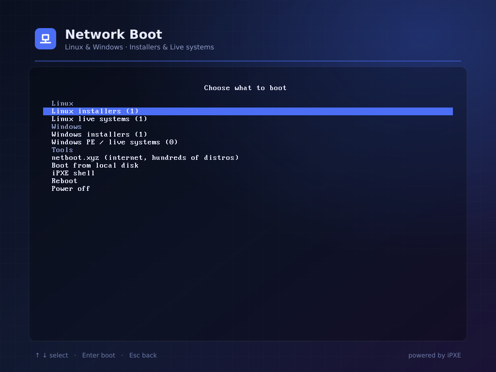
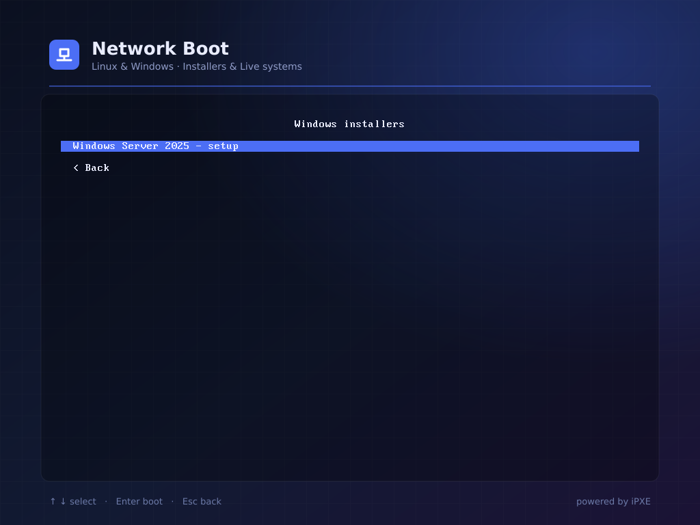
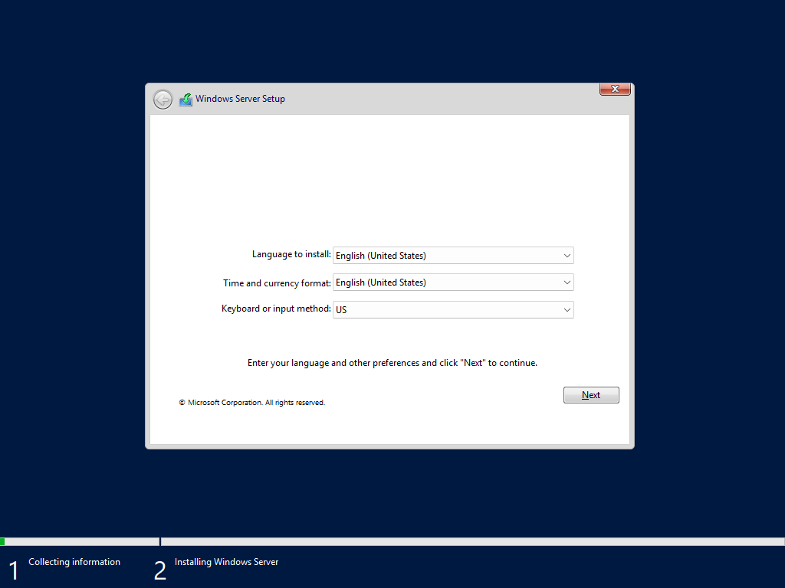
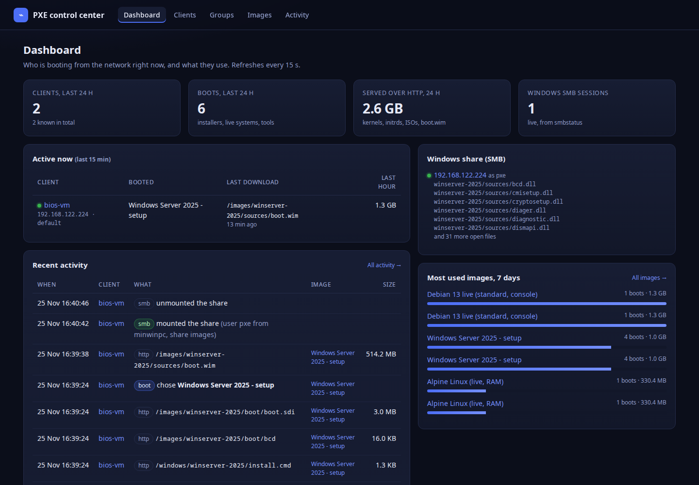
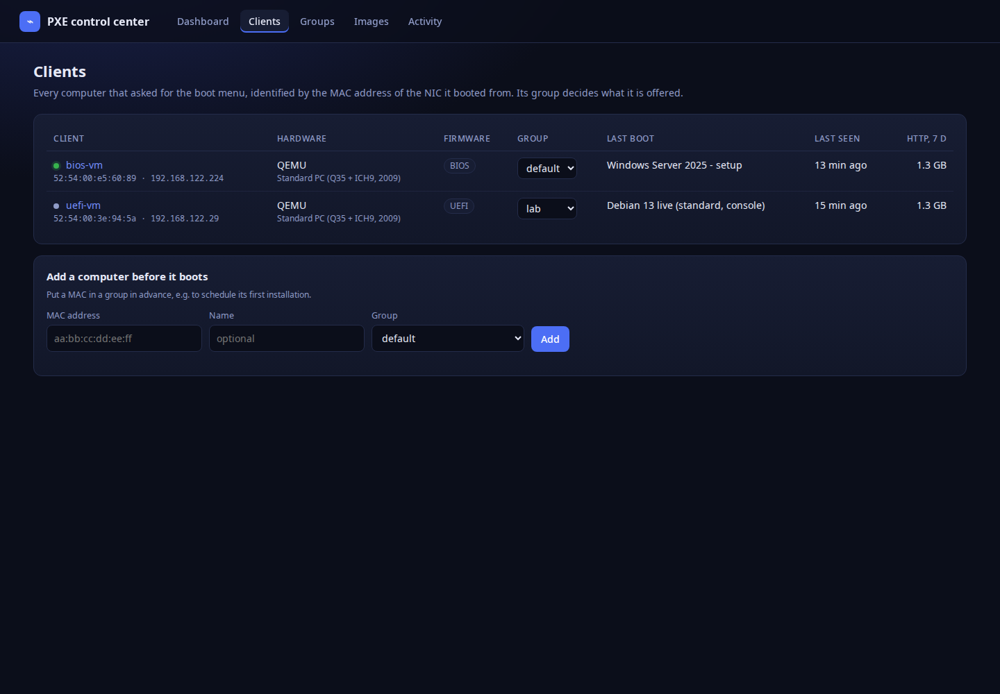
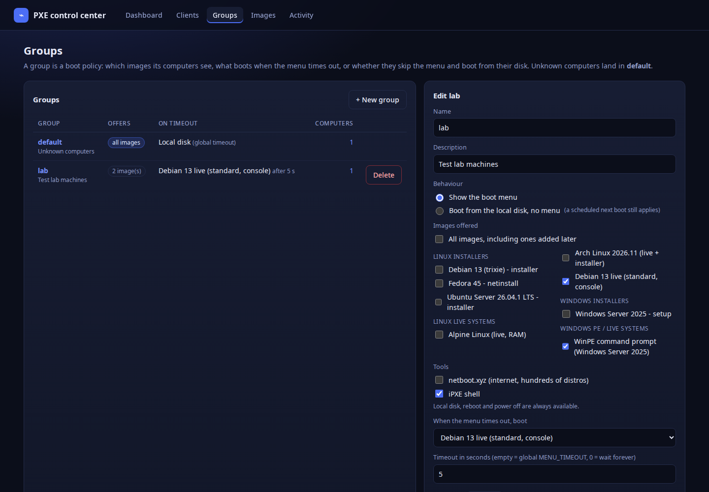

# Graphical PXE server

Network-boot Linux and Windows — installers and live systems — from a graphical
menu, on BIOS and UEFI machines, without touching your router's DHCP.

```
 client NIC ──DHCP──► router (gives the IP)
            ──DHCP──► dnsmasq ProxyDHCP (adds "boot undionly.kpxe / snponly.efi")
            ──TFTP──► custom iPXE (framebuffer + PNG + HTTPS, embedded script)
            ──HTTP──► nginx: kernels, initrds, ISOs, boot.wim
                      └─ /boot.ipxe → controller: menu built for this MAC
 Windows    ──SMB───► samba: Windows Setup reads install.wim from the share
```

| Service   | Port(s)          | Role                                             |
|-----------|------------------|--------------------------------------------------|
| `dnsmasq` | 67, 4011 udp, 69 | ProxyDHCP + TFTP, ships the iPXE binaries        |
| `http`    | 80               | nginx serving `data/http`                        |
| `smb`     | 445              | samba share `images` (read-only, user `pxe`)     |
| `controller` | 8000          | control center: per-client menus, usage, web UI  |

All of them use host networking (PXE relies on broadcasts).

## Screenshots

| Main menu | Submenu | Windows Setup over the network |
|---|---|---|
|  |  |  |

| Control center | Clients | Group (boot policy) |
|---|---|---|
|  |  |  |

More in [`docs/screenshots/`](docs/screenshots/).

## Requirements

- Docker with compose, Python 3.11+, `7z` (Arch: `pacman -S 7zip`)
- Secure Boot **disabled** on the clients (the iPXE binaries are not signed)

## Quick start

```sh
./pxe init               # detects interface, IP and subnet -> .env
                         # (catalog.toml is created from catalog.example.toml)
./pxe build              # downloads netboot files, writes data/http/boot.ipxe
docker compose up -d --build
```

Boot a machine from the network: you get the menu with Debian (installer),
Alpine (live) and netboot.xyz out of the box.

## Adding systems

```sh
./pxe types                                   # supported types
./pxe import ~/isos/ubuntu-24.04-desktop.iso -t ubuntu-live    -l "Ubuntu 24.04 Desktop"
./pxe import ~/isos/Win11_24H2.iso           -t windows-install -l "Windows 11 24H2"
./pxe import ~/isos/HBCD_PE_x64.iso          -t windows-pe      -l "Hiren's BootCD PE"
./pxe build                                   # always rebuild after changes
```

`import` extracts the ISO into `data/http/images/<id>/` and appends an entry to
`catalog.toml`. Edit `catalog.toml` to rename, recategorise (`category`), tweak
kernel arguments (`args` / `extra_args`) or disable entries (`enabled = false`).

| Type              | Use for                                         | Notes                         | Tested with (BIOS/UEFI VMs)          |
|-------------------|-------------------------------------------------|-------------------------------|--------------------------------------|
| `ubuntu-live`     | Ubuntu/Mint/Pop desktop (casper)                | whole ISO downloaded to RAM   | not yet                              |
| `ubuntu-server`   | Ubuntu live-server installer                    | whole ISO downloaded to RAM   | Ubuntu Server 26.04.1 (BIOS)         |
| `debian-live`     | Debian live ISOs                                | fetches the squashfs          | Debian 13.8 live standard (BIOS)     |
| `fedora-live`     | Fedora Workstation / spins                      | whole ISO downloaded to RAM   | not yet                              |
| `redhat-install`  | Fedora Server DVD, Rocky, Alma, RHEL DVD         | packages from extracted tree  | not yet                              |
| `redhat-netinst`  | netinstall ISOs                                 | packages from the internet    | Fedora 45 Everything netinst (UEFI)  |
| `arch`            | Arch Linux                                      | live + installer              | Arch 2026.11.01 (UEFI)               |
| `netboot`         | kernel/initrd from URLs (no ISO)                | see `catalog.toml` examples   | Debian 13 installer, Alpine (both)   |
| `custom`          | anything else: set `kernel`, `initrd`, `args`   |                               | —                                    |
| `windows-install` | Windows 10/11/Server ISOs                       | wimboot + setup over SMB      | Windows Server 2025 (BIOS)           |
| `windows-pe`      | WinPE-based live ISOs                           | wimboot, boots `boot.wim`     | WinPE from Server 2025 (UEFI)        |

"Downloaded to RAM" types need RAM larger than the ISO plus some headroom
(Ubuntu Server 26.04 needed more than 4 GB; it works with 8 GB).

Other per-entry options in `catalog.toml`:

- `files_from = "<other-id>"` — reuse the files of an already imported entry
  (e.g. the same Windows `boot.wim` as installer and as plain WinPE).
- `wimboot_args = "index=1"` — extra wimboot arguments; `index=` picks the
  image inside `boot.wim` (in Windows media, 1 = plain WinPE, 2 = Setup).
- `args` may use `{base}`, `{iso}`, `{server}` and also raw iPXE variables
  such as `${netX/mac:hexhyp}`.

## Control center

A small web app (`services/controller`, FastAPI + SQLite) that sits behind
nginx and answers `/boot.ipxe`:

- **Per-client menus.** iPXE sends the MAC address of the NIC it booted from,
  plus manufacturer, model, serial, UUID and BIOS/UEFI. The controller looks up
  the computer's **group** and builds a menu with only what that group allows.
  Unknown computers are registered on their first boot into the group
  `default`.
- **Groups** are boot policies: which images are offered (or all of them,
  including future ones), which tools (netboot.xyz, iPXE shell), what boots
  when the menu times out and after how long, or "skip the menu and boot from
  the local disk".
- **Next boot.** Schedule an entry for one computer: on its next network boot
  it starts that entry after 5 s (press `m` for the menu), once.
- **Usage.** Every menu choice is reported by the menu itself
  (`imgfetch` of `/ipxe/event`, freed at once). Downloads come from nginx's JSON
  access log and are attributed to a client by IP → MAC (the IP iPXE announced)
  and to an image by path. The Windows share is audited with samba's
  `full_audit` (who mounts it, which files are opened) and `smbstatus --json`
  (live sessions). Logs are shared through `data/logs` (an `emptyDir` in
  Kubernetes) and truncated once consumed; history is kept 90 days
  (`PXE_KEEP_DAYS`).
- If the controller is down, nginx falls back to the static full menu written
  by `./pxe build`, so booting never depends on it.

The web UI listens on port 8000. With docker compose set `ADMIN_PASSWORD` in
`.env` (user `admin`); in Kubernetes publish the `pxe-controller` Service with
an Ingress behind your SSO, and keep `externalTrafficPolicy: Local` on the
LoadBalancer so nginx and samba see the real client IPs.

MAC addresses can be spoofed: groups decide what is *offered*, they are not
access control.

## Windows notes

- WinPE must have a driver for the client's NIC. Real Intel/Realtek NICs are
  fine; in VMs use `e1000e`, not `virtio`.
- Windows Setup is started from `\\SERVER_IP\images\<id>\sources\setup.exe`
  with the `SMB_USER`/`SMB_PASS` credentials from `.env`.
- The script runs `wpeutil DisableFirewall` first: with the WinPE firewall on,
  the client tries IPsec (IKE, UDP 500) towards the server and `net use` fails
  with *System error 53*.
- The share has `acl allow execute always`: extracted files are `0644`, and
  without it Windows gets *Access is denied* running `setup.exe`.
- Newer `setup.exe` returns immediately (it hands over to `SetupHost.exe`); the
  script waits for it so WinPE does not reboot underneath it.

## Running on Kubernetes with the router's DHCP (MikroTik)

Instead of the ProxyDHCP container, the router's DHCP announces the boot:

```
 client ──DHCP──► MikroTik: IP + next-server=router + undionly.kpxe | snponly.efi
                            + option 224 = 192.168.1.214
        ──TFTP──► MikroTik /ip tftp (the two iPXE binaries)
        ──HTTP──► 192.168.1.214 (MetalLB) → pod: nginx  ┐ same Longhorn
 WinPE  ──SMB───► 192.168.1.214            → pod: samba ┘ PVC
```

The embedded iPXE script takes the HTTP server from option 224 when present,
then falls back to ProxyDHCP / next-server, so the same binaries work both ways.
TFTP stays on the router on purpose: TFTP replies from ephemeral ports and does
not survive the NAT of a Kubernetes Service.

- Kubernetes: `deploy/k8s` (kustomize): one pod with nginx, samba and an
  rsync `sync` container, a PVC for `data/http` and a LoadBalancer Service
  (MetalLB) on a fixed LAN IP. Set that IP, the samba image and the SMB
  password before applying.
- Router: `deploy/mikrotik/pxe.rsc` (RouterOS 7; undo with `pxe-remove.rsc`).
  Adjust the IPs in it. Gotchas it already handles: option 224 needs
  `force=yes` (RouterOS only sends requested options and iPXE does not request
  224) and an `s'...'` string value; the UEFI matcher needs `address-pool` set,
  otherwise it defaults to static leases only.

```sh
docker compose build dnsmasq
docker buildx build --platform linux/amd64,linux/arm64 \
    -t <registry>/pxe-samba:0.1.0 --push services/samba
kubectl apply -k deploy/k8s

./pxe export-ipxe ipxe-bin               # binaries for the router's TFTP
scp ipxe-bin/undionly.kpxe ipxe-bin/snponly.efi admin@<router>:pxe/
scp deploy/mikrotik/pxe.rsc admin@<router>:
ssh admin@<router> '/import file-name=pxe.rsc'

cp .env.example .env.k8s                 # SERVER_IP = the LoadBalancer IP,
                                         # SMB_PASS = the Secret, K8S_CONTEXT
./pxe --env .env.k8s build               # bakes SERVER_IP into install.cmd
./pxe --env .env.k8s push                # rsync data/http into the PVC
```

## Configuration (`.env`)

| Variable        | Meaning                                                      |
|-----------------|--------------------------------------------------------------|
| `INTERFACE`     | NIC facing the clients                                       |
| `SERVER_IP`     | this server's IP (used by Windows Setup for SMB)             |
| `DHCP_MODE`     | `proxy` (keep your router's DHCP) or `full` (isolated labs)  |
| `PROXY_SUBNET`  | network address for proxy mode, e.g. `192.168.1.0`           |
| `DHCP_RANGE`…   | only for `full` mode                                         |
| `SMB_USER/PASS` | share credentials                                            |
| `MENU_TIMEOUT`  | seconds before booting the local disk (0 = wait forever); default for groups without their own timeout |
| `ADMIN_PASSWORD`| password of the control center web UI (user `admin`); empty = no login |
| `TZ`            | time zone shown in the control center                        |

## Customising the look

`assets/background.svg` → render to `assets/background.png` (1024×768) and run
`./pxe build`. The menu text is drawn by iPXE inside the area
`left 80, right 80, top 152, bottom 76`; colours are set at the top of the
generated `boot.ipxe` (see `render_menu()` in `pxe`).

## Troubleshooting

- `docker compose logs -f dnsmasq` shows every PXE request (`log-dhcp`).
- `docker compose logs -f http` shows what each client downloads.
- If the menu never appears, check that nothing else answers PXE on the LAN and
  that UDP 67/69/4011 and TCP 80/445 are open on this host.
